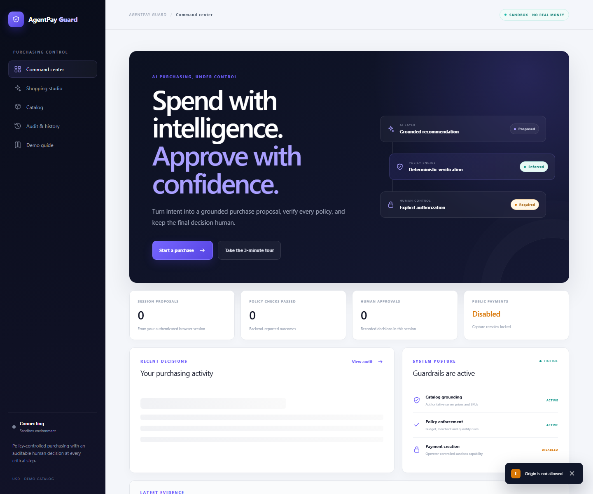
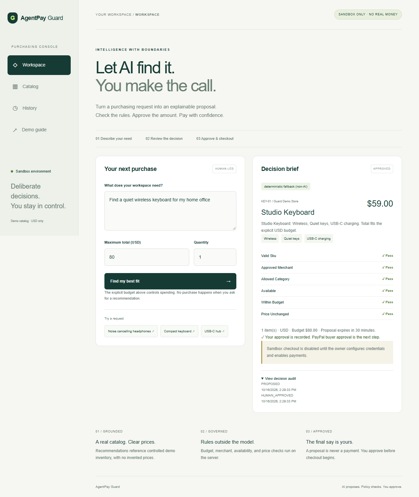
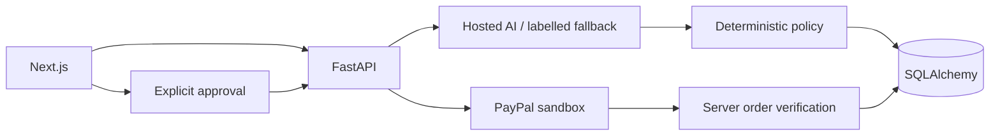

# AgentPay Guard

AI-powered purchasing with verifiable decisions, policy-controlled spending, and PayPal checkout.

An assistant can suggest a purchase; it should not silently spend your money. AgentPay Guard turns a request into a catalog-grounded proposal, checks deterministic policies, records your approval, and initiates PayPal sandbox checkout.

**Status:** one genuine hosted Gemini request and one genuine PayPal Sandbox buyer approval are verified. The approved order was USD 59.00 and reached `BUYER_APPROVED` only after a server-side PayPal lookup. No capture occurred and `CAPTURE_ENABLED=false`. The public Vercel/Render deployment and Neon schema revision are reachable, but the hosted proposal flow is currently blocked by a mismatched Render `FRONTEND_ORIGIN` value. Fictional inventory, no fulfillment, sandbox only.

## Features

- Natural-language requests, explicit USD budget, quantity, catalog comparison.
- Hosted Gemini adapter with native Pydantic structured output; clearly labelled deterministic non-AI fallback.
- Server checks SKU, merchant, category, availability, budget and price changes.
- Explicit approval before official PayPal checkout; server-verified buyer approval and separately gated capture code.
- Isolated session history and timestamped decision audit.
- Responsive workspace, failure/empty states and judge demo guide.

## Local setup — Windows PowerShell

Requires Python 3.12+, Node 22+, npm, and Chrome for browser tests.

```powershell
Copy-Item .env.example .env
python -m venv .venv
.\.venv\Scripts\python -m pip install -r backend/requirements.txt
cd backend
..\.venv\Scripts\python -m alembic upgrade head
..\.venv\Scripts\python -m uvicorn app.main:app --env-file ../.env --port 8000
```

In a second terminal from repository root:

```powershell
cd frontend
npm ci
npm run dev
```

Open http://localhost:3000. Without credentials, the fallback recommendation, policies, approval and audit work; checkout is disabled. Root `.env` is ignored. Configure secrets locally, never in chat, screenshots or commits.

For hosted AI set `AI_PROVIDER=gemini`, `GEMINI_API_KEY`, and `GEMINI_MODEL=gemini-flash-latest` in ignored `.env`. The API resolves the alias to an actual model version during explicit evaluation. For PayPal follow [sandbox setup](docs/PAYPAL_INTEGRATION.md). `PAYMENTS_ENABLED` permits sandbox order creation; the separate server-only `CAPTURE_ENABLED` gate must also be explicitly enabled before capture. PostgreSQL uses a TLS `DATABASE_URL=postgresql+psycopg://...?sslmode=require`; SQLite is the local development default. See the [minimum-cost deployment runbook](docs/DEPLOYMENT.md).

## Validation

```powershell
cd backend
..\.venv\Scripts\python -m pytest -q
cd ../frontend
npm run lint
npm run typecheck
npm run build
npm run test:e2e
```

Browser tests start the backend using `python`; activate the virtual environment first if dependencies are not installed globally. Do not set payment or AI credentials for offline tests. See [evaluation](docs/EVALUATION.md) for actual results and test boundaries.

## Architecture and trust

Actual production UI (captured October 24, 2026; the visible origin warning is a known hosted configuration blocker):



[Production mobile screenshot](docs/screenshots/production-command-center-mobile.png)

Actual local workflow UI (non-AI fallback; sandbox checkout disabled):



[Mobile screenshot](docs/screenshots/workspace-mobile.png)



Stack: Next.js, React, TypeScript, Tailwind, FastAPI, Pydantic, SQLAlchemy, PostgreSQL/SQLite, pytest, Playwright, PayPal Orders/JavaScript SDK and the Google Gen AI SDK.

Gemini failures use a deterministic fallback whose mode is visibly labelled `non-AI`; fallback output is never reported as hosted inference. The model cannot call payment tools. Client callbacks cannot mark an order approved or paid. No live PayPal endpoint is configurable. Capture code exists but has not been exercised against PayPal. Disposable PostgreSQL 17.11 passed migration and persistence verification; Neon is reachable at schema revision `20261018_0001`. Hosted proposal persistence and restart recovery remain unverified until the exact-origin configuration blocker is corrected. This is a hackathon build, not production-certified financial infrastructure.

Read [feasibility](docs/FEASIBILITY.md), [architecture](docs/ARCHITECTURE.md), [database migrations](docs/DATABASE.md), [security](docs/SECURITY.md), [limitations](docs/KNOWN_LIMITATIONS.md), [deployment](docs/DEPLOYMENT.md), [progress](docs/PROGRESS.md), and [blockers](docs/BLOCKERS.md).

License: [MIT](LICENSE).
