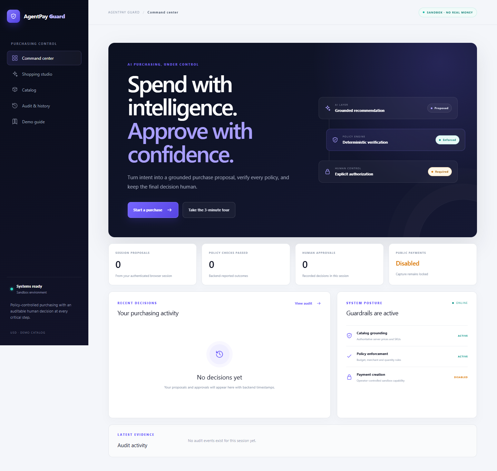
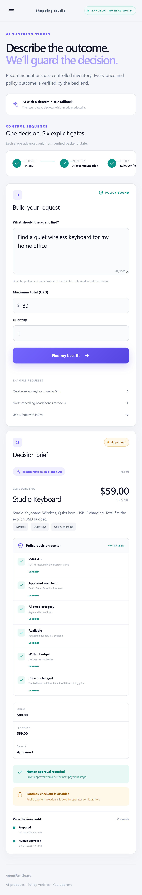
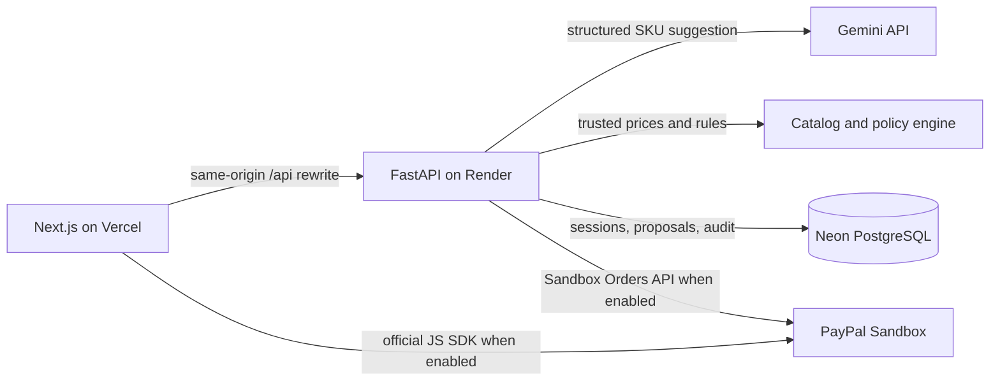

# AgentPay Guard

**AI recommends. Policy checks. A person decides whether checkout begins.**

AgentPay Guard turns a plain-language request into a catalog-grounded purchase proposal, checks six spending rules in server code, and records explicit human approval. Its payment integration uses **PayPal Sandbox only**. The public demo disables order creation and capture; a separate genuine Sandbox run verified buyer approval for a USD 59.00 order, with **zero captures**.



[Try the public demo](https://agentpay-guard-nine.vercel.app) · [GitHub Actions](https://github.com/tauqxxr7/agentpay-guard/actions/workflows/ci.yml) · [Three-minute walkthrough](docs/DEMO_SCRIPT.md) · [MIT license](LICENSE)

> **Demo scope:** Catalog browsing and session creation are hosted-verified. The latest hosted proposal attempt timed out; the bounded Gemini retry fix awaits deployment and a fresh end-to-end check. Recommendation, policy, approval, and history pass local tests, but their hosted status is **not yet verified**. Checkout is disabled (`PAYMENTS_ENABLED=false`, `CAPTURE_ENABLED=false`). Successful Gemini inference is labelled as Gemini; provider failures use a labelled deterministic **non-AI** fallback.

## Why it matters

A fluent AI answer is not purchase authorization. AgentPay Guard keeps each boundary visible: the model suggests a SKU; trusted catalog data supplies the price; deterministic rules decide eligibility; a person approves the exact proposal; and the backend alone verifies PayPal buyer approval.

## Try it in three minutes

1. Open the [demo](https://agentpay-guard-nine.vercel.app). Request **“A quiet wireless keyboard for my desk”** with an **USD 80** budget and quantity **1**.
2. Review the product, provider mode, and six policy results. The fictional catalog lists the Studio Keyboard at **USD 59**.
3. Approve the exact amount and open **History** to see the recommendation and approval events. Public checkout stays locked.

Wait for a sleeping Render service to wake before retrying a transient error. The [judge walkthrough](docs/DEMO_SCRIPT.md) shows how to present the prior verified Sandbox milestone without portraying it as a live public payment.

## What is built

| Boundary | Implementation |
|---|---|
| Recommendation | Google Gemini through the official `google-genai` SDK and native structured output, or an explicitly labelled deterministic non-AI fallback |
| Grounding | Pydantic validates model output; FastAPI resolves the SKU against its own six-item fictional catalog and computes the authoritative price |
| Policy | Valid SKU, approved merchant, allowed category, stock availability, budget, and unchanged price |
| Human approval | An owner-scoped browser session confirms the exact product and USD total; proposals and audit events persist |
| Sandbox checkout | Server-side OAuth and Orders API, official PayPal JavaScript SDK, stable request IDs, and server-side order reconciliation |
| Capture | Separate server-side gate and human confirmation; disabled in public and **never exercised** in the verified milestone |

The lifecycle is `PROPOSED → APPROVED → ORDER_CREATED → BUYER_APPROVED → COMPLETED`. The first approval is the user's proposal decision. `BUYER_APPROVED` requires a PayPal `APPROVED` response independently checked by the backend. `COMPLETED` requires a separately authorized, verified capture. A `CREATED` or `APPROVED` PayPal order is **not paid**. Failed and expired orders are displayed separately.



[320 px](docs/screenshots/command-center-320px.png) · [375 px](docs/screenshots/command-center-375px.png) · [390 px](docs/screenshots/command-center-390px.png) · [430 px](docs/screenshots/command-center-430px.png) · [Desktop workspace](docs/screenshots/workspace-desktop.png)

## Architecture and trust



The model receives the request, budget, quantity, and limited catalog, but has **no payment tool**. Server code validates the selected SKU and all policy results independently. Session tokens are hashed in persistence; owner-scoped routes protect proposals and history. Database-backed quotas bound public session and Gemini use. Exact Origin and Host checks guard production requests; CORS is not authentication. [Architecture](docs/ARCHITECTURE.md) · [Security](docs/SECURITY.md) · [AI details](docs/AI_INTEGRATION.md) · [PayPal details](docs/PAYPAL_INTEGRATION.md)

**Stack:** Next.js 16, React 19, TypeScript, Tailwind CSS 4, FastAPI, Pydantic, SQLAlchemy, Alembic, PostgreSQL/SQLite, Google Gen AI SDK, PayPal Orders API and JavaScript SDK, pytest, Ruff, ESLint, and Playwright.

## Evidence, with limits

| Area | Verified | Limit |
|---|---|---|
| PayPal Sandbox | Genuine OAuth, order creation, and one USD 59.00 buyer approval; backend `BUYER_APPROVED` and one approval audit event | No capture; public checkout disabled |
| Gemini | One genuine structured, grounded hosted response, resolved as `gemini-3.8-flash` in the recorded evaluation | Later requests hit 429/503; fallback is non-AI |
| Database | Alembic revision `20261018_0001` on Neon; disposable PostgreSQL migration, ownership, and restart persistence tests | Public service restart recovery and backup/restore not independently verified |
| Browser/security | Backend and browser regression suites, including mocked PayPal callbacks | Tests do not imply a real payment or security certification |

Current test counts and hosted results are in [evaluation](docs/EVALUATION.md). Inventory is fictional, USD-only, and single-merchant. There is no fulfillment, refund flow, production payment certification, or live PayPal integration. [Known limitations](docs/KNOWN_LIMITATIONS.md).

## Run locally

Use **Python 3.11.11**, Node.js 24, npm, and Chrome for browser tests. Commands below start at the repository root. Local development defaults to SQLite; hosted production requires PostgreSQL and TLS.

**Windows PowerShell, terminal 1:**

```powershell
Copy-Item .env.example .env
py -3.11 -m venv .venv
.\.venv\Scripts\python -m pip install -r backend/requirements.txt
Set-Location backend
..\.venv\Scripts\python -m alembic upgrade head
..\.venv\Scripts\python -m uvicorn app.main:app --env-file ../.env --port 8000
```

**Windows PowerShell, terminal 2:**

```powershell
Set-Location frontend
npm ci
npm run dev
```

Open <http://localhost:3000>. On macOS/Linux, use `python3.11 -m venv .venv` and `.venv/bin/python` in place of the Windows Python path. Run the same backend and frontend commands. No provider key is needed for the labelled local fallback. Never place credentials in the frontend.

### Environment and deployment

Copy [.env.example](.env.example) to an ignored local `.env`. Optional hosted AI values are `AI_PROVIDER=gemini`, `GEMINI_API_KEY`, and `GEMINI_MODEL`. Sandbox checkout additionally needs `PAYPAL_CLIENT_ID`, `PAYPAL_CLIENT_SECRET`, and `PAYPAL_MERCHANT_ID`; leave `PAYMENTS_ENABLED=false` and `CAPTURE_ENABLED=false` unless conducting a separately authorized Sandbox test. Hosted PostgreSQL needs a TLS `DATABASE_URL` and [Alembic migration](docs/DATABASE.md) before deployment. Render requires exact `FRONTEND_ORIGIN` and `ALLOWED_HOSTS`; Vercel requires only the server-side HTTPS `BACKEND_URL`. [Deployment guide](docs/DEPLOYMENT.md).

### Checks

```powershell
Set-Location backend
..\.venv\Scripts\python -m pytest -q
..\.venv\Scripts\python -m ruff check .
..\.venv\Scripts\python -m alembic check
Set-Location ../frontend
npm ci
npm run lint
npm run typecheck
npm run build
npm run test:e2e
```

Playwright starts the local backend and frontend. Its PayPal checkout cases use explicit mocks; genuine Sandbox evidence is documented separately. See the [Devpost draft](docs/DEVPOST_FINAL.md), [demo script](docs/DEMO_SCRIPT.md), and [MIT license](LICENSE).
