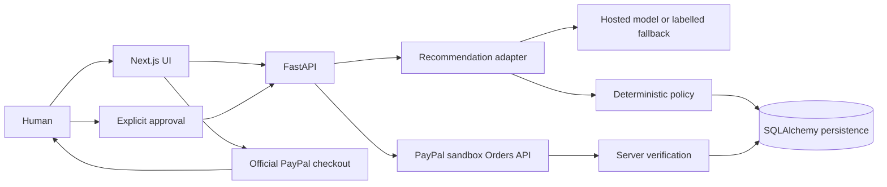

# Architecture

Monorepo: `frontend/` Next.js/TypeScript/Tailwind; `backend/app/` FastAPI/Pydantic/SQLAlchemy; `backend/tests/` pytest; `frontend/e2e/` Playwright.

Money is integer cents; USD is the only supported currency. The user specifies a binding budget separately from free text. Each proposal snapshots product, quantity, total and policy outcomes. Approval and order creation revalidate current catalog data. Proposals expire after 30 minutes.

State path: PROPOSED → APPROVED → ORDER_CREATED → COMPLETED. Only authenticated server reads of matching completed captures can enter COMPLETED. Cancelled popup and pending/failed payment do not imply success. Timeout retries reuse the proposal's idempotency key. History refresh reconciles ambiguous outcomes.

Anonymous 256-bit bearer sessions expire after 24 hours, are hashed in the database and held in browser sessionStorage. There is no cross-device account recovery. PostgreSQL row locks serialize state transitions; SQLite is a single-process local test option, not the intended concurrent deployment database.

The provider returns only a SKU or clarification. Server catalog attributes generate explanations, preventing model-invented prices or rationale from being displayed. The model cannot access payment credentials or tools. The fallback supports only explicit categories and selected attribute keywords.
